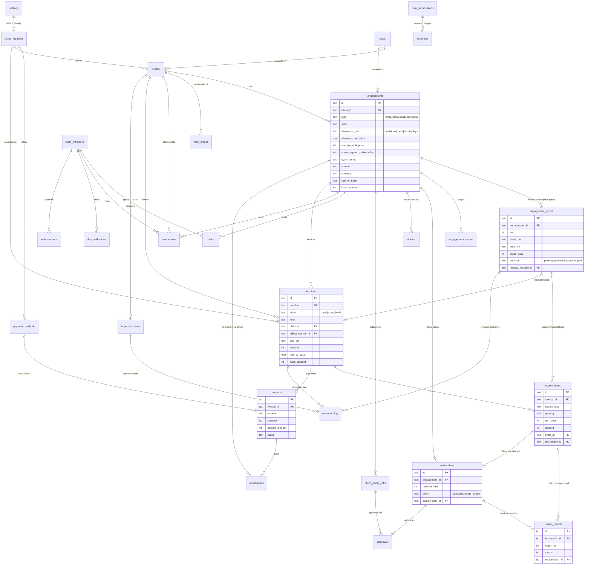

# Freelancer OS — Database Design (v1)

> **ملخّص للمالك**
> - قاعدة بيانات واحدة **SQLite** (ملف واحد على جهازك) عبر **Drizzle**، بأنواع قابلة للنقل إلى Postgres لاحقاً دون إعادة تصميم.
> - كل المبالغ **أعداد صحيحة بالهللة/السنت** (لا كسور عشرية عائمة)، وكل سجل مالي يحفظ: المبلغ + العملة + سعر الصرف لحظتها + المبلغ بالريال السعودي. التقارير بالريال مع زر تحويل للدولار.
> - جدول واحد `engagements` للمشروع والريتينر والاشتراك، ومعه جدول `engagement_cycles` يحفظ كل دورة (بداية/نهاية/سماح/قرار: تجديد أو سماح أو إيقاف) كتاريخ لا يُمسح.
> - **لا نخزّن أي قيمة محسوبة**: حالة الفاتورة، المدفوع، الرصيد، استهلاك الحصة، أيام الاشتراك المتبقية، صحة العميل، «تمّت الموافقة» — كلها تُحسب من السجلات الأصلية بالاستعلام.
> - الحارس مبني على البيانات: جولة المراجعة المفوترة مربوطة ببند الفاتورة الذي غطّاها، فلا يمكن فوترتها مرتين ولا نسيانها.
> - خزنة الوصول تحفظ نصاً مشفّراً فقط، والمفتاح مشتق من كلمة سر لا تُخزَّن في القاعدة. رابط العميل العام يُحفظ كـhash، وكل موافقة سجلّ دائم.
> - 30 جدولاً. في آخر الملف: خريطة التحويل من أنواع الواجهة الحالية + قرارات المالك الخمسة (محسومة).

---

## 1. Overview & key design decisions

| Decision | Choice | Why |
|---|---|---|
| Engine | SQLite 3 (single file `data/freelancer-os.db`), WAL mode, `PRAGMA foreign_keys = ON` | Free, zero-ops, one file to back up. Local server on owner's machine serves the app, team (1–3) and the public client link. |
| Access | Drizzle ORM (`drizzle-orm/sqlite-core`), migrations via `drizzle-kit` | Same schema file can target `pg-core` later. No SQLite-only features except partial indexes (Postgres supports them too). |
| IDs | `TEXT`, prefixed ULID, e.g. `eng_01J8Z…`, `inv_01J8Z…` | Portable, sortable by creation time, readable in logs; matches the UI's `uid(prefix)` pattern. Exception: `settings.id` (INTEGER, always 1). |
| Dates | `*_on` = calendar date `TEXT 'YYYY-MM-DD'` in the owner's timezone. `*_at` = instant `TEXT` ISO-8601 UTC `'YYYY-MM-DDTHH:MM:SS.sssZ'` | Lexicographic compare works; `date()`/`julianday()` work in SQLite; maps to `date`/`timestamptz` in Postgres. |
| Booleans | `INTEGER` 0/1 + `CHECK (x IN (0,1))` | Drizzle `integer({ mode: 'boolean' })`. |
| Enums | `TEXT` + `CHECK (x IN (...))` | Drizzle `text({ enum: [...] })`; becomes a Postgres enum or check later. |
| Money | **INTEGER minor units** (halala / cent / fils). `amount`, `base_amount`, `unit_price`, `applied_amount` are all minor units. | No float drift in sums/balances; exact equality for "paid in full". All three currencies (SAR, USD, YER) have exponent 2, so `base_amount = ROUND(amount * rate_to_base)` is valid directly in minor units. UI formats with `/100`. |
| Exchange rate | `rate_to_base REAL` = SAR per 1 unit of the record currency (SAR→1, USD→3.75, YER→~0.0024). Snapshot on every money row, copied from `exchange_rates` at write time, overridable per record (e.g. real USDT rate received). | Fixes original defect #7 (rate stuck at 1). Historical reports never change when today's rate changes. |
| Base / report currency | Base = **SAR** (fixed in v1). USD toggle = `base_amount / current USD rate_to_base`. | SAR is pegged to USD at 3.75, so converting base → USD at report time is historically safe; no second snapshot column needed. |
| Timestamps | Every table has `created_at TEXT NOT NULL` and `updated_at TEXT NOT NULL` (set by app via Drizzle `$defaultFn` / `$onUpdateFn`). Append-only tables (`approvals`, `reminder_log`) have `created_at` only. | Portable (no triggers needed). |
| Deletion policy | **No generic soft delete.** Business entities that invoices point to (`clients`, `engagements`, `billing_identities`, `payment_methods`, `team_members`) get `archived_at`. Issued invoices are never deleted — they are **voided** (`state='void'`). Drafts, tasks, stages, entries may be hard-deleted (with the unified confirm dialog). FKs default to `ON DELETE RESTRICT`; `CASCADE` only on pure children (noted per table). | Keeps financial history intact; avoids `WHERE deleted_at IS NULL` everywhere. |
| Derived data | Never stored: invoice status/paid/balance, allowance usage, meter state, subscription days-left/grace state, client health, deliverable approved flag, task done flag. See §5. | Single source of truth; the mock store's `used`/`paid` mutations are exactly the class of bug to avoid. |
| Write-time snapshots (allowed) | `invoices.amount` (sum of items, frozen at issue), `base_amount` everywhere, `invoice_items.amount`, cycle `amount`/`included_units`. | These are *facts at a moment*, not state. Draft invoice totals are recomputed on every item edit; after issue the invoice is immutable. |
| Files | Uploaded files live on disk under `data/files/<yyyy>/<ulid>.<ext>`; DB stores metadata + `sha256`. | Keeps DB small. Backup = `VACUUM INTO` snapshot + `data/files/` folder, zipped together. |
| Settings | One row in `settings` + `exchange_rates` + `message_templates`. No `localStorage` data (UI prefs like theme may stay local). | Fixes defects #5, #18, #19 (duplicated invoice-number formats and due-day rules). |

Conventions used below: `PK` primary key, `FK→t` foreign key to `t.id`, `NN` not null. The standard columns `id TEXT PK`, `created_at`, `updated_at` are **omitted from the column tables** unless they differ.

---

## 2. Entity-relationship diagram



Tables not drawn for brevity: `exchange_rates`, `message_templates`, `expenses`↔`engagements` (optional cost link), `calendar_events`, `tickets` details, `leads` details. All 30 tables are specified in §3.

---

## 3. Tables

### 3.1 Configuration

#### `settings` — single source of truth for business rules
One row only (`CHECK (id = 1)`). Every rule the UI needs (numbering, due days, reminder offsets, guard thresholds) is read from here; nothing is hard-coded twice.

| column | type | null | default | notes |
|---|---|---|---|---|
| id | INTEGER PK | NN | 1 | `CHECK (id = 1)` |
| business_name | TEXT | NN | | shown in app header |
| base_currency | TEXT | NN | `'SAR'` | `CHECK (base_currency = 'SAR')` in v1 |
| alt_report_currency | TEXT | NN | `'USD'` | toggle target |
| timezone | TEXT | NN | `'Asia/Aden'` | defines what "today" means for `*_on` |
| locale | TEXT | NN | `'ar'` | `'ar'`/`'en'` |
| default_billing_identity_id | TEXT | Y | | FK→billing_identities |
| invoice_prefix | TEXT | NN | `'INV'` | number = `{prefix}-{year}-{seq padded}` |
| invoice_seq_year | INTEGER | NN | current year | sequence resets when year changes |
| invoice_seq_next | INTEGER | NN | 1 | incremented inside the *issue* transaction |
| invoice_seq_pad | INTEGER | NN | 3 | |
| default_due_days | INTEGER | NN | 7 | `CHECK (>= 0)`; the **only** due-day rule |
| reminder_offsets_json | TEXT | NN | `'[0,7,14]'` | days after `due_on`; validated with zod |
| renewal_notice_days | INTEGER | NN | 7 | remind N days before cycle end |
| default_revision_limit | INTEGER | NN | 2 | copied into new deliverables |
| default_grace_days | INTEGER | NN | 5 | copied into new cycles |
| meter_near_ratio | REAL | NN | 0.8 | guard "near" threshold |
| due_soon_days | INTEGER | NN | 7 | subscription "due" window |
| vault_kdf_salt | TEXT | Y | | base64; set when vault is initialised |
| vault_kdf_params_json | TEXT | Y | | e.g. `{"alg":"argon2id","m":65536,"t":3,"p":1}` |
| vault_key_check | TEXT | Y | | ciphertext of a constant, to verify the passphrase |
| pricing_profile_json | TEXT | Y | | pricing-engine inputs (income, weeks off, hours/week, tax %, profit %) — not queried, so JSON is fine |

#### `exchange_rates` — rate history (replaces `settings.rates` in the store)
| column | type | null | default | notes |
|---|---|---|---|---|
| currency | TEXT | NN | | `CHECK (currency IN ('USD','YER'))` — SAR is always 1 |
| rate_to_base | REAL | NN | | `CHECK (rate_to_base > 0)`; SAR per 1 unit |
| effective_on | TEXT | NN | | |
| source | TEXT | NN | `'manual'` | `'manual'`/`'import'` |
| note | TEXT | Y | | e.g. "Aden market rate" |

`UNIQUE (currency, effective_on)`. Current rate: `SELECT rate_to_base FROM exchange_rates WHERE currency=? AND effective_on <= :today ORDER BY effective_on DESC LIMIT 1`.

#### `message_templates` — WhatsApp texts (Arabic), stored in DB
| column | type | null | default | notes |
|---|---|---|---|---|
| key | TEXT | NN | | `'invoice_send'`, `'reminder_due'`, `'reminder_overdue'`, `'renewal_notice'`, `'portal_link'`, `'lead_follow_up'` |
| locale | TEXT | NN | `'ar'` | |
| body | TEXT | NN | | `{{client_name}}`, `{{invoice_number}}`, `{{balance}}`, `{{due_on}}`, `{{pay_methods}}`, `{{link}}` |

`UNIQUE (key, locale)`. Messages are phrased "from the system" (weak point #2: no social embarrassment).

### 3.2 People & access

#### `team_members`
| column | type | null | default | notes |
|---|---|---|---|---|
| name | TEXT | NN | | |
| role | TEXT | NN | | `CHECK (role IN ('owner','assistant'))` |
| email | TEXT | NN | | `UNIQUE`; login id — free text since 2026-09-25 (an email or any name), matched case-insensitively |
| whatsapp | TEXT | Y | | |
| password_hash | TEXT | NN | | argon2id (PHC string). **Built nullable**: NULL = can't sign in until `npm run auth:set-password` sets one |
| is_active | INTEGER | NN | 1 | bool |
| archived_at | TEXT | Y | | |

`CREATE UNIQUE INDEX team_one_owner ON team_members(role) WHERE role = 'owner';`
Authorization rule (enforced in the API layer, not the DB): **assistant** can read/write only `tasks WHERE assignee_id = me`, their own `time_entries`, their own `daily_reflections`, and read the title of the engagement a task belongs to. No money tables, no vault, no settings.

#### `auth_sessions`
| column | type | null | default | notes |
|---|---|---|---|---|
| id | TEXT PK | NN | | SHA-256 of the session cookie token (raw token never stored) |
| member_id | TEXT | NN | | FK→team_members `ON DELETE CASCADE` |
| expires_at | TEXT | NN | | |
| last_seen_at | TEXT | Y | | |
| user_agent | TEXT | Y | | first 300 chars |
| created_at | TEXT | NN | | |

Index `(member_id)`. Expired rows are swept on each sign-in (a handful of rows, so no
`expires_at` index). Built in migration `0002`; see ARCHITECTURE.md §5 for the cookie.

### 3.3 Billing identities & clients

#### `billing_identities` — personal name vs studio
| column | type | null | default | notes |
|---|---|---|---|---|
| kind | TEXT | NN | | `CHECK (kind IN ('personal','studio'))` |
| name | TEXT | NN | | printed on invoice |
| legal_name | TEXT | Y | | |
| tagline | TEXT | Y | | |
| initials | TEXT | NN | | fallback avatar |
| color | TEXT | NN | | hex |
| logo_attachment_id | TEXT | Y | | FK→attachments (`kind='logo'`) |
| whatsapp / email / address | TEXT | Y | | |
| tax_number | TEXT | Y | | optional, informational only |
| invoice_footer | TEXT | Y | | |
| archived_at | TEXT | Y | | |

#### `payment_methods` — per identity (bank, Kuraimi, USDT, cash)
| column | type | null | default | notes |
|---|---|---|---|---|
| billing_identity_id | TEXT | NN | | FK→billing_identities |
| kind | TEXT | NN | | `CHECK (kind IN ('bank','kuraimi','usdt','cash'))` |
| label | TEXT | NN | | "الراجحي — حساب الشركة" |
| details | TEXT | NN | | IBAN / Kuraimi account / USDT address+network; printed on invoice (not a secret) |
| currency | TEXT | Y | | currency this account accepts; NULL = any |
| position | INTEGER | NN | 0 | order on invoice |
| archived_at | TEXT | Y | | |

Index `(billing_identity_id, position)`.

#### `clients`
| column | type | null | default | notes |
|---|---|---|---|---|
| kind | TEXT | NN | | `CHECK (kind IN ('person','company'))` |
| name | TEXT | NN | | contact person / display name |
| company | TEXT | Y | | |
| billing_identity_id | TEXT | NN | | FK→billing_identities — which identity invoices this client |
| whatsapp | TEXT | Y | | E.164, used for `wa.me` links |
| email / city / country | TEXT | Y | | |
| timezone | TEXT | NN | `'Asia/Riyadh'` | local time on client card |
| currency | TEXT | NN | `'SAR'` | `CHECK (currency IN ('SAR','USD','YER'))`; default for new engagements |
| color | TEXT | NN | | |
| lead_source | TEXT | Y | | copied from lead; revenue-by-source report |
| notes | TEXT | Y | | |
| archived_at | TEXT | Y | | |

Indexes `(archived_at, name)`, `(billing_identity_id)`. No `health` column (derived, §5.5).

#### `vault_entries` — encrypted client access vault
| column | type | null | default | notes |
|---|---|---|---|---|
| client_id | TEXT | NN | | FK→clients `ON DELETE CASCADE` |
| label | TEXT | NN | | plaintext, e.g. "cPanel", "Instagram" (safe to list) |
| url | TEXT | Y | | plaintext |
| ciphertext | TEXT | NN | | base64 of AEAD-encrypted JSON `{username, secret, notes}` |
| nonce | TEXT | NN | | base64, unique per encryption (24 bytes XChaCha20 or 12 bytes AES-GCM) |
| algo | TEXT | NN | `'xchacha20poly1305'` | `CHECK (algo IN ('xchacha20poly1305','aes-256-gcm'))` |
| key_version | INTEGER | NN | 1 | for key rotation |

Rules: key = KDF(owner passphrase, `settings.vault_kdf_salt`), held in server memory only after unlock; never in DB, env file, or client bundle. AAD = `vault_entries.id` (ciphertext can't be moved to another row). Re-encrypt with a new nonce on every edit. Decrypt only on explicit "reveal" by the owner; the API never returns ciphertext or plaintext in list endpoints. Index `(client_id)`.

### 3.4 Pipeline

#### `leads` — lead → proposal → negotiation → won/lost
| column | type | null | default | notes |
|---|---|---|---|---|
| name | TEXT | NN | | |
| company / whatsapp | TEXT | Y | | |
| service | TEXT | NN | | what they want |
| stage | TEXT | NN | `'lead'` | `CHECK (stage IN ('lead','proposal','negotiation','won','lost'))` |
| amount / currency / rate_to_base / base_amount | INT/TEXT/REAL/INT | Y | | estimate (money quad; all NULL or all set) |
| source | TEXT | Y | | "referral", "Instagram"… |
| proposal_sent_on | TEXT | Y | | |
| last_contact_on | TEXT | Y | | |
| next_follow_up_on | TEXT | Y | | drives follow-up reminder |
| lost_reason | TEXT | Y | | |
| closed_at | TEXT | Y | | set when won/lost |
| client_id | TEXT | Y | | FK→clients (existing client, or created on win) |
| engagement_id | TEXT | Y | | FK→engagements (created on win) |
| position | INTEGER | NN | 0 | kanban order within stage |
| notes | TEXT | Y | | |

CHECKs: `stage <> 'won' OR (client_id IS NOT NULL AND engagement_id IS NOT NULL)`; `stage NOT IN ('won','lost') OR closed_at IS NOT NULL`; money quad all-or-nothing. Conversion runs in one transaction: insert client (if new) → insert engagement (`lead_id`) → update lead. Index `(stage, position)`, `(next_follow_up_on)`.

### 3.5 Engagement engine

#### `engagements` — one table for project / retainer / subscription
| column | type | null | default | notes |
|---|---|---|---|---|
| client_id | TEXT | NN | | FK→clients |
| billing_identity_id | TEXT | Y | | override; NULL = client's identity |
| lead_id | TEXT | Y | | FK→leads |
| type | TEXT | NN | | `CHECK (type IN ('project','retainer','subscription'))` |
| status | TEXT | NN | `'active'` | `CHECK (status IN ('active','paused','completed','cancelled'))` — user-set lifecycle; *grace/lapsed are derived* |
| title | TEXT | NN | | |
| description | TEXT | Y | | scope summary |
| amount | INTEGER | NN | | project = total contract value; retainer/subscription = price per cycle |
| currency | TEXT | NN | | `CHECK (currency IN ('SAR','USD','YER'))` |
| rate_to_base / base_amount | REAL / INTEGER | NN | | snapshot at creation |
| start_on | TEXT | NN | | |
| end_on | TEXT | Y | | project deadline / fixed end |
| allowance_unit | TEXT | NN | | `CHECK (allowance_unit IN ('revisions','hours','tickets','days'))` |
| allowance_included | REAL | Y | | retainer: hours or tickets **per cycle**; NULL for project/subscription |
| overage_unit_price | INTEGER | Y | | price of one extra revision / hour / ticket, engagement currency |
| default_revision_limit | INTEGER | Y | | project: copied into new deliverables |
| scope_agreed_deliverables | INTEGER | Y | | project: deliverables in the original contract |
| cycle_period | TEXT | Y | | `CHECK (cycle_period IN ('monthly','quarterly','yearly'))` |
| grace_days | INTEGER | Y | | subscription default grace, copied into each cycle |
| next_action | TEXT | Y | | "one next action per engagement" |
| next_action_on | TEXT | Y | | |
| lessons_note | TEXT | Y | | post-engagement lesson ("where I under-estimated and why") — the lessons archive is a query over this column |
| archived_at | TEXT | Y | | |

Type-specific CHECK constraints (table level):
```sql
CHECK (
  (type = 'project'
     AND allowance_unit = 'revisions'
     AND default_revision_limit IS NOT NULL AND default_revision_limit >= 0
     AND scope_agreed_deliverables IS NOT NULL AND scope_agreed_deliverables >= 0
     AND cycle_period IS NULL AND allowance_included IS NULL)
  OR
  (type = 'retainer'
     AND allowance_unit IN ('hours','tickets')
     AND cycle_period IS NOT NULL
     AND allowance_included IS NOT NULL AND allowance_included > 0
     AND overage_unit_price IS NOT NULL)
  OR
  (type = 'subscription'
     AND allowance_unit = 'days'
     AND cycle_period IS NOT NULL
     AND grace_days IS NOT NULL AND grace_days >= 0
     AND allowance_included IS NULL)
),
CHECK (end_on IS NULL OR end_on >= start_on),
CHECK (amount >= 0)
```
Indexes: `(client_id)`, `(type, status)`, `(next_action_on)`.

#### `engagement_cycles` — one row per retainer/subscription period (history, never overwritten)
| column | type | null | default | notes |
|---|---|---|---|---|
| engagement_id | TEXT | NN | | FK→engagements `ON DELETE CASCADE` |
| seq | INTEGER | NN | | 1, 2, 3… |
| starts_on | TEXT | NN | | inclusive |
| ends_on | TEXT | NN | | exclusive; = renewal date |
| amount | INTEGER | NN | | cycle price snapshot (engagement currency) |
| included_units | REAL | Y | | retainer: snapshot of `allowance_included`; NULL for subscription |
| grace_days | INTEGER | NN | 0 | snapshot of engagement grace |
| grace_extended_days | INTEGER | NN | 0 | added by the "grant grace" decision |
| decision | TEXT | NN | `'pending'` | `CHECK (decision IN ('pending','renewed','grace','stopped'))` |
| decided_at | TEXT | Y | | |
| decided_by | TEXT | Y | | FK→team_members |
| decision_note | TEXT | Y | | e.g. "client asked for 3 more days" |
| renewal_invoice_id | TEXT | Y | | FK→invoices (the invoice that bills the **next** cycle) |
| service_stopped_on | TEXT | Y | | owner confirms they manually disabled the service |

Constraints: `UNIQUE (engagement_id, seq)`; `CHECK (ends_on > starts_on)`; `CHECK (decision <> 'renewed' OR renewal_invoice_id IS NOT NULL)`; `CHECK (decision <> 'stopped' OR decided_at IS NOT NULL)`.
`CREATE UNIQUE INDEX cycle_one_open ON engagement_cycles(engagement_id) WHERE decision IN ('pending','grace');` — at most one open cycle.
Index `(ends_on)` for the renewal scan.

Decisions (subscription end, one transaction each):
- **Renew** → create renewal invoice (`kind='renewal'`, item `source_kind='renewal'`, `cycle_id` = new cycle) → insert cycle `seq+1` (`starts_on` = old `ends_on`) → old cycle `decision='renewed'`.
- **Grace** → `decision='grace'`, `grace_extended_days += n` (still open).
- **Stop** → `decision='stopped'`; engagement `status='completed'` (or `paused`); reminder to disable service manually; `service_stopped_on` set when owner confirms.

Retainers open cycles the same way; renewing a retainer cycle also freezes that cycle's usage for reporting.

#### `engagement_stages`
| column | type | null | default | notes |
|---|---|---|---|---|
| engagement_id | TEXT | NN | | FK `ON DELETE CASCADE` |
| title | TEXT | NN | | |
| position | INTEGER | NN | | `UNIQUE (engagement_id, position)` |
| completed_at | TEXT | Y | | done = `completed_at IS NOT NULL` |

#### `deliverables`
| column | type | null | default | notes |
|---|---|---|---|---|
| engagement_id | TEXT | NN | | FK→engagements |
| stage_id | TEXT | Y | | FK→engagement_stages `ON DELETE SET NULL` |
| title | TEXT | NN | | |
| due_on | TEXT | Y | | |
| revision_limit | INTEGER | NN | | `CHECK (>= 0)`; copied from engagement default |
| origin | TEXT | NN | `'contract'` | `CHECK (origin IN ('contract','change_scope'))` |
| invoice_item_id | TEXT | Y | | FK→invoice_items: the line that billed this scope addition |
| position | INTEGER | NN | 0 | |
| cancelled_at | TEXT | Y | | excluded from guards |

`CHECK (origin = 'contract' OR invoice_item_id IS NOT NULL)` — a change-scope deliverable always has its invoice line. No `approved` column (derived from `approvals`). Index `(engagement_id, position)`, `(due_on)`.

#### `review_rounds` — feedback / revision rounds
| column | type | null | default | notes |
|---|---|---|---|---|
| deliverable_id | TEXT | NN | | FK→deliverables |
| round_no | INTEGER | NN | | `= COUNT(existing)+1`, assigned inside the insert transaction |
| received_on | TEXT | NN | | |
| note | TEXT | NN | | feedback text |
| source | TEXT | NN | `'owner'` | `CHECK (source IN ('owner','assistant','client_link'))` |
| created_by | TEXT | Y | | FK→team_members (NULL when from client link) |
| portal_link_id | TEXT | Y | | FK→client_portal_links — set when source='client_link' |
| invoice_item_id | TEXT | Y | | FK→invoice_items — set when this out-of-scope round has been billed |

`CHECK ((source = 'client_link') = (portal_link_id IS NOT NULL))`; `CHECK (source = 'client_link' OR created_by IS NOT NULL)`.

`UNIQUE (deliverable_id, round_no)`. Replaces the UI's `invoiced?: boolean` with a traceable link. Index `(deliverable_id)`, `(invoice_item_id)`.

#### `tickets` — retainer tickets (only for `allowance_unit='tickets'`)
| column | type | null | default | notes |
|---|---|---|---|---|
| engagement_id | TEXT | NN | | FK→engagements |
| title | TEXT | NN | | |
| opened_on | TEXT | NN | | determines the cycle it counts in |
| closed_on | TEXT | Y | | |
| counts_to_allowance | INTEGER | NN | 1 | bool; 0 = goodwill / not counted |
| note | TEXT | Y | | |

Index `(engagement_id, opened_on)`.

### 3.6 Client portal

#### `client_portal_links` — public status + approve link
| column | type | null | default | notes |
|---|---|---|---|---|
| engagement_id | TEXT | NN | | FK→engagements |
| token_hash | TEXT | NN | | SHA-256 of a 32-byte random URL token; `UNIQUE` |
| token_hint | TEXT | NN | | last 4 chars, to recognise the link in the UI |
| created_by | TEXT | NN | | FK→team_members |
| expires_at | TEXT | Y | | NULL = until revoked |
| revoked_at | TEXT | Y | | |
| last_viewed_at | TEXT | Y | | |
| view_count | INTEGER | NN | 0 | |

Lookup: `WHERE token_hash = sha256(:token) AND revoked_at IS NULL AND (expires_at IS NULL OR expires_at > :now)`. The portal endpoint exposes only: engagement title, stage list, deliverables (title, due, rounds count, approval state). No money, no vault. Rate-limit by IP. Index `(engagement_id)`.

#### `approvals` — append-only record of every approval / change request
| column | type | null | default | notes |
|---|---|---|---|---|
| deliverable_id | TEXT | NN | | FK→deliverables |
| review_round_id | TEXT | Y | | FK→review_rounds: round being approved, or round created by "request changes" |
| source | TEXT | NN | | `CHECK (source IN ('client_link','owner'))` — owner records a WhatsApp approval |
| portal_link_id | TEXT | Y | | FK→client_portal_links |
| recorded_by | TEXT | Y | | FK→team_members (owner source) |
| decision | TEXT | NN | | `CHECK (decision IN ('approved','changes_requested'))` |
| signer_name | TEXT | Y | | name typed by client |
| comment | TEXT | Y | | |
| ip_hash | TEXT | Y | | SHA-256(ip + server salt) — evidence without storing raw IP |
| user_agent | TEXT | Y | | |
| created_at | TEXT | NN | | no `updated_at` (immutable) |

CHECKs: `(source = 'client_link') = (portal_link_id IS NOT NULL)`; `source <> 'owner' OR recorded_by IS NOT NULL`. "Request changes" from the link inserts a `review_rounds` row (`source='client_link'`) **and** runs the guard — so the owner immediately sees if it is out of scope. Index `(deliverable_id, created_at)`.

### 3.7 Money

#### `invoices`
| column | type | null | default | notes |
|---|---|---|---|---|
| number | TEXT | Y | | `UNIQUE`; assigned at issue (drafts don't burn numbers) |
| state | TEXT | NN | `'draft'` | `CHECK (state IN ('draft','issued','void'))` — the only stored status |
| kind | TEXT | NN | `'standard'` | `CHECK (kind IN ('standard','deposit','overage','renewal','scope'))` |
| client_id | TEXT | NN | | FK→clients |
| engagement_id | TEXT | Y | | FK→engagements |
| billing_identity_id | TEXT | NN | | FK — snapshot of the identity at creation (logo/methods on the PDF) |
| issue_on | TEXT | NN | | |
| due_on | TEXT | NN | | `= issue_on + settings.default_due_days` unless edited |
| currency | TEXT | NN | | |
| rate_to_base | REAL | NN | | snapshot |
| amount | INTEGER | NN | 0 | total = Σ items.amount (recomputed while draft, frozen at issue) |
| base_amount | INTEGER | NN | 0 | `ROUND(amount * rate_to_base)` |
| note | TEXT | Y | | |
| issued_at / voided_at | TEXT | Y | | |
| void_reason | TEXT | Y | | |
| last_sent_at | TEXT | Y | | last "send via WhatsApp" click |

CHECKs: `state = 'draft' OR (number IS NOT NULL AND issued_at IS NOT NULL)`; `state <> 'void' OR voided_at IS NOT NULL`; `due_on >= issue_on`; `amount >= 0`. Indexes `(client_id, issue_on)`, `(engagement_id)`, `(state, due_on)`.
Numbering (single rule): inside the issue transaction, `if settings.invoice_seq_year <> year(issue_on) then reset seq to 1`; `number = prefix || '-' || year || '-' || lpad(seq, pad)`; `seq += 1`.

#### `invoice_items`
| column | type | null | default | notes |
|---|---|---|---|---|
| invoice_id | TEXT | NN | | FK→invoices `ON DELETE CASCADE` (only drafts can be deleted) |
| position | INTEGER | NN | | |
| description | TEXT | NN | | |
| quantity | REAL | NN | 1 | `CHECK (quantity > 0)`; hours may be fractional |
| unit_price | INTEGER | NN | | minor units, invoice currency |
| amount | INTEGER | NN | | `ROUND(quantity * unit_price)` |
| source_kind | TEXT | NN | `'manual'` | `CHECK (source_kind IN ('manual','deposit','revision_overage','retainer_overage','scope_change','renewal'))` |
| deliverable_id | TEXT | Y | | FK — for `revision_overage`, `scope_change` |
| cycle_id | TEXT | Y | | FK→engagement_cycles — for `retainer_overage`, `renewal` |

CHECKs: `source_kind NOT IN ('retainer_overage','renewal') OR cycle_id IS NOT NULL`; `source_kind <> 'revision_overage' OR deliverable_id IS NOT NULL`. Index `(invoice_id, position)`, `(cycle_id)`, `(deliverable_id)`.

#### `payments` — local methods + manual proof
| column | type | null | default | notes |
|---|---|---|---|---|
| invoice_id | TEXT | NN | | FK→invoices |
| amount / currency / rate_to_base / base_amount | INT/TEXT/REAL/INT | NN | | what was actually received (may differ from invoice currency, e.g. USDT for a SAR invoice) |
| applied_amount | INTEGER | NN | | amount credited against the invoice, **in invoice currency** |
| received_on | TEXT | NN | | |
| payment_method_id | TEXT | Y | | FK→payment_methods |
| method_kind | TEXT | NN | | snapshot `CHECK (IN ('bank','kuraimi','usdt','cash'))` |
| reference | TEXT | Y | | transfer no. / tx hash |
| status | TEXT | NN | `'confirmed'` | `CHECK (status IN ('pending_confirmation','confirmed','rejected'))` — proof uploaded but not yet verified = pending |
| confirmed_at / confirmed_by | TEXT | Y | | FK→team_members |
| note | TEXT | Y | | |

`CHECK (applied_amount > 0 AND amount > 0)`; `CHECK (status <> 'confirmed' OR confirmed_at IS NOT NULL)`. Proof = `attachments` row with `kind='payment_proof'`, `payment_id`. Only confirmed payments count. Index `(invoice_id)`, `(received_on)`.

#### `expenses` — owner's own spending
| column | type | null | default | notes |
|---|---|---|---|---|
| title | TEXT | NN | | |
| category | TEXT | NN | | `CHECK (category IN ('software','equipment','contractors','marketing','other'))` |
| amount / currency / rate_to_base / base_amount | | NN | | money quad |
| spent_on | TEXT | NN | | |
| vendor | TEXT | Y | | |
| own_subscription_id | TEXT | Y | | FK→own_subscriptions — this row is a subscription charge |
| engagement_id | TEXT | Y | | FK — direct project cost (contractor) → engagement profitability |
| note | TEXT | Y | | receipt via attachments (`kind='receipt'`) |

`UNIQUE (own_subscription_id, spent_on)` (idempotent renewal job). Index `(spent_on)`.

#### `own_subscriptions` — owner's tools (Figma, hosting…), separate from client subscriptions
| column | type | null | default | notes |
|---|---|---|---|---|
| name | TEXT | NN | | |
| vendor / category | TEXT | Y | | |
| amount / currency / rate_to_base / base_amount | | NN | | current price |
| period | TEXT | NN | | `CHECK (period IN ('monthly','yearly'))` |
| started_on | TEXT | NN | | |
| next_renewal_on | TEXT | NN | | |
| cancelled_on | TEXT | Y | | |
| remind_days_before | INTEGER | NN | 3 | |

Renewal job (runs at server start + daily, catches up missed days): for each active sub with `next_renewal_on <= today` → insert `expenses` row (`own_subscription_id`, `spent_on = next_renewal_on`, current rate) → advance `next_renewal_on`. This is how net income subtracts own subscriptions **without double counting** (fixes defect #24).

### 3.8 Work, time & day

#### `tasks`
| column | type | null | default | notes |
|---|---|---|---|---|
| title | TEXT | NN | | |
| notes | TEXT | Y | | |
| engagement_id | TEXT | Y | | FK→engagements `ON DELETE SET NULL` |
| stage_id | TEXT | Y | | FK→engagement_stages `ON DELETE SET NULL` |
| assignee_id | TEXT | NN | | FK→team_members — drives assistant visibility |
| created_by | TEXT | NN | | FK→team_members |
| due_on | TEXT | Y | | |
| completed_at | TEXT | Y | | done = `completed_at IS NOT NULL` (fixes defect #4) |
| completed_by | TEXT | Y | | FK→team_members |
| carried_over_count | INTEGER | NN | 0 | incremented by "carry over to tomorrow" |
| position | INTEGER | NN | 0 | |

Indexes `(assignee_id, completed_at, due_on)`, `(engagement_id)`.

#### `time_entries` — attribution to client/engagement
| column | type | null | default | notes |
|---|---|---|---|---|
| member_id | TEXT | NN | | FK→team_members |
| client_id | TEXT | Y | | FK→clients (set automatically from engagement) |
| engagement_id | TEXT | Y | | FK→engagements |
| deliverable_id / task_id | TEXT | Y | | optional FKs |
| work_on | TEXT | NN | | local date — decides which retainer cycle it counts in |
| started_at | TEXT | Y | | timer sessions |
| minutes | INTEGER | NN | | `CHECK (minutes > 0)` |
| description | TEXT | Y | | |
| entry_type | TEXT | NN | `'manual'` | `CHECK (entry_type IN ('manual','timer'))` |
| billable | INTEGER | NN | 1 | bool |
| counts_to_allowance | INTEGER | NN | 1 | bool; retainer hours meter uses this |

`CHECK (engagement_id IS NULL OR client_id IS NOT NULL)`. Indexes `(engagement_id, work_on)`, `(client_id, work_on)`, `(member_id, work_on)`.

#### `daily_reflections` — end-of-day ritual
| column | type | null | default | notes |
|---|---|---|---|---|
| member_id | TEXT | NN | | FK→team_members |
| on_date | TEXT | NN | | |
| reflection | TEXT | NN | | free text |
| carried_count | INTEGER | NN | 0 | snapshot of tasks carried that evening |

`UNIQUE (member_id, on_date)`. "Completed today" list is derived from `tasks.completed_at` (not stored).

### 3.9 Dates, reminders, files

#### `important_dates` — domains, SSL, licenses (not tied only to clients)
| column | type | null | default | notes |
|---|---|---|---|---|
| title | TEXT | NN | | "example.com domain" |
| kind | TEXT | NN | | `CHECK (kind IN ('domain','ssl','license','hosting','other'))` |
| due_on | TEXT | NN | | next expiry |
| recurrence | TEXT | NN | `'yearly'` | `CHECK (recurrence IN ('none','monthly','yearly'))` |
| remind_days_before | INTEGER | NN | 14 | |
| client_id / engagement_id | TEXT | Y | | optional FKs |
| handled_on | TEXT | Y | | for `none`; recurring dates roll `due_on` forward instead |
| notes | TEXT | Y | | |
| archived_at | TEXT | Y | | |

Index `(due_on)`.

#### `calendar_events` — manual events only (the calendar itself is a derived view)
| column | type | null | default | notes |
|---|---|---|---|---|
| title | TEXT | NN | | |
| starts_on | TEXT | NN | | |
| ends_on | TEXT | Y | | |
| start_time | TEXT | Y | | `'HH:MM'`, NULL = all day |
| client_id / engagement_id | TEXT | Y | | |
| created_by | TEXT | NN | | FK→team_members |
| notes | TEXT | Y | | |

Calendar = UNION of `deliverables.due_on`, `engagement_cycles.ends_on` (open cycles), `invoices.due_on` (unpaid), `important_dates.due_on`, `own_subscriptions.next_renewal_on`, `leads.next_follow_up_on`, `calendar_events`.

#### `reminder_log` — what was sent/dismissed (the schedule itself is derived)
| column | type | null | default | notes |
|---|---|---|---|---|
| kind | TEXT | NN | | `CHECK (kind IN ('invoice_due','subscription_renewal','important_date','lead_follow_up','own_subscription'))` |
| invoice_id / cycle_id / important_date_id / lead_id / own_subscription_id | TEXT | Y | | exactly one set (CHECK below) |
| occurrence_on | TEXT | NN | | the date the reminder refers to (due_on, ends_on…) |
| offset_days | INTEGER | NN | | e.g. 0 / 7 / 14 (after) or −7 (before) |
| action | TEXT | NN | | `CHECK (action IN ('sent','dismissed'))` |
| message_body | TEXT | Y | | rendered WhatsApp text actually sent (evidence) |
| acted_by | TEXT | NN | | FK→team_members |
| dedupe_key | TEXT | NN | | `kind:targetId:occurrence_on:offset_days`, `UNIQUE` |
| created_at | TEXT | NN | | append-only |

```sql
CHECK ((CASE WHEN invoice_id IS NOT NULL THEN 1 ELSE 0 END)
     + (CASE WHEN cycle_id IS NOT NULL THEN 1 ELSE 0 END)
     + (CASE WHEN important_date_id IS NOT NULL THEN 1 ELSE 0 END)
     + (CASE WHEN lead_id IS NOT NULL THEN 1 ELSE 0 END)
     + (CASE WHEN own_subscription_id IS NOT NULL THEN 1 ELSE 0 END) = 1)
```
Why derived schedule: offsets live once in `settings`; a paid invoice simply stops producing due reminders; nothing to clean up. Pending query in §5.6.

#### `attachments` — agreement evidence, contracts, payment proofs, receipts, logos
| column | type | null | default | notes |
|---|---|---|---|---|
| kind | TEXT | NN | | `CHECK (kind IN ('agreement_chat','contract','payment_proof','receipt','deliverable_file','logo','other'))` |
| file_name | TEXT | NN | | original name |
| mime_type | TEXT | NN | | allow-list: images, pdf |
| size_bytes | INTEGER | NN | | `CHECK (size_bytes > 0)`; server max e.g. 15 MB |
| sha256 | TEXT | NN | | dedupe + integrity |
| storage_path | TEXT | NN | | relative to data dir; server-generated (never from user input) |
| client_id / engagement_id / deliverable_id / payment_id / expense_id / lead_id | TEXT | Y | | owner FKs |
| note | TEXT | Y | | e.g. "WhatsApp 12 Sep — agreed 3 revisions" |
| uploaded_by | TEXT | NN | | FK→team_members |

CHECKs: `kind = 'logo' OR COALESCE(client_id, engagement_id, deliverable_id, payment_id, expense_id, lead_id) IS NOT NULL`; `kind <> 'payment_proof' OR payment_id IS NOT NULL`. Indexes on each owner FK.

---

## 4. Allowance guard → data

All guard reads are queries; all guard writes are ordinary inserts. Every consumption path (add feedback, log time, open ticket, portal "request changes") calls the same service function that runs the guard query **in the same transaction** and returns the result for inline display (spec rule: guard on every path).

### 4.1 Project — revision rounds vs limit (per deliverable)
```sql
SELECT d.id,
       d.revision_limit                                        AS limit_,
       COUNT(r.id)                                             AS used,
       COUNT(r.id) + 1                                         AS next_round,
       (COUNT(r.id) + 1) <= d.revision_limit                   AS next_in_scope,
       MAX(0, COUNT(r.id) - d.revision_limit)                  AS over_count,
       SUM(CASE WHEN r.round_no > d.revision_limit
                 AND r.invoice_item_id IS NULL THEN 1 ELSE 0 END) AS unbilled_over
FROM deliverables d
LEFT JOIN review_rounds r ON r.deliverable_id = d.id
WHERE d.engagement_id = :engagementId AND d.cancelled_at IS NULL
GROUP BY d.id;
```
"Generate invoice" for a deliverable = one `invoice_items` row (`source_kind='revision_overage'`, `quantity = unbilled_over`, `unit_price = engagements.overage_unit_price`) + `UPDATE review_rounds SET invoice_item_id = :item WHERE deliverable_id = :d AND round_no > revision_limit AND invoice_item_id IS NULL` — same transaction. Voiding that invoice clears the links (`SET invoice_item_id = NULL`) so the rounds become billable again.

Engagement-level meter for a project = sums of the above (`used`, `limit_`, `over_count`); state `over` if any `over_count > 0`, `near` if `used / limit_ >= settings.meter_near_ratio`.

### 4.2 Project — scope extras (deliverables beyond contract)
```sql
SELECT e.scope_agreed_deliverables                                          AS agreed,
       SUM(CASE WHEN d.origin = 'contract' THEN 1 ELSE 0 END)               AS tracked_contract,
       SUM(CASE WHEN d.origin = 'change_scope' THEN 1 ELSE 0 END)           AS change_scope_count,
       MAX(0, SUM(CASE WHEN d.origin = 'contract' THEN 1 ELSE 0 END)
              - e.scope_agreed_deliverables)                                AS extras
FROM engagements e
LEFT JOIN deliverables d ON d.engagement_id = e.id AND d.cancelled_at IS NULL
WHERE e.id = :engagementId
GROUP BY e.id;
```
**Change scope** (one click): insert invoice (`kind='scope'`) + item (`source_kind='scope_change'`, fee) + deliverable (`origin='change_scope'`, `invoice_item_id` = item). Current contract value is derived:
```sql
current_value = e.amount + COALESCE((SELECT SUM(ii.amount) FROM invoice_items ii
   JOIN invoices i ON i.id = ii.invoice_id
   WHERE i.engagement_id = e.id AND ii.source_kind = 'scope_change' AND i.state <> 'void'), 0)
```
(The mock store's `value += fee` and `scopeDeliverables += 1` mutations disappear.) "Bill scope additions" for `extras` converts those deliverables to `origin='change_scope'` with their invoice item.

### 4.3 Retainer — usage per cycle (hours or tickets)
```sql
-- current cycle
SELECT * FROM engagement_cycles
WHERE engagement_id = :e AND decision IN ('pending','grace')
ORDER BY seq DESC LIMIT 1;

-- used (hours)
SELECT COALESCE(SUM(minutes), 0) / 60.0 AS used
FROM time_entries
WHERE engagement_id = :e AND counts_to_allowance = 1
  AND work_on >= :starts_on AND work_on < :ends_on;

-- used (tickets)
SELECT COUNT(*) AS used FROM tickets
WHERE engagement_id = :e AND counts_to_allowance = 1
  AND opened_on >= :starts_on AND opened_on < :ends_on;

-- already billed overage for this cycle
SELECT COALESCE(SUM(ii.quantity), 0) AS billed
FROM invoice_items ii JOIN invoices i ON i.id = ii.invoice_id
WHERE ii.cycle_id = :cycleId AND ii.source_kind = 'retainer_overage' AND i.state <> 'void';
```
`overage = max(0, used - included_units)`; `unbilled = overage - billed`; `ratio = used / included_units`; state = `over` if `overage > 0`, `near` if `ratio >= meter_near_ratio`, else `ok`. Billing overage inserts one item with `quantity = unbilled`, `cycle_id` — usage is **never reset** (the mock's `used = included` hack goes away).

### 4.4 Subscription — days left, due, grace, lapsed
```sql
SELECT c.*,
       CAST(julianday(c.ends_on) - julianday(:today) AS INTEGER)       AS days_left,
       CAST(julianday(c.ends_on) - julianday(c.starts_on) AS INTEGER)  AS included_days,
       CAST(julianday(:today) - julianday(c.starts_on) AS INTEGER)     AS used_days,
       c.grace_days + c.grace_extended_days                            AS grace_total
FROM engagement_cycles c
WHERE c.engagement_id = :e AND c.decision IN ('pending','grace')
ORDER BY c.seq DESC LIMIT 1;
```
```
state =
  engagement.status in ('paused','completed','cancelled') → that status
  days_left < -grace_total           → 'lapsed'   (decision required: renew / stop)
  days_left < 0                      → 'grace'
  days_left <= settings.due_soon_days → 'due'      (show decision card: grace / renewal invoice / stop)
  else                               → 'active'
```
Renewal reminders fire at `ends_on - renewal_notice_days` and on `ends_on`. The system never disables the service; "stop" only records the decision and creates a manual reminder.

---

## 5. Derived values — never stored

| Value | Computation |
|---|---|
| **Invoice paid** | `SELECT COALESCE(SUM(applied_amount),0) FROM payments WHERE invoice_id=? AND status='confirmed'` |
| **Invoice balance** | `MAX(0, invoices.amount - paid)` |
| **Invoice status** | `state='void'`→void · `state='draft'`→draft · `paid >= amount`→paid · `:today > due_on`→overdue · `paid > 0`→partial · else unpaid |
| **Deliverable approved** | latest `approvals` row for the deliverable has `decision='approved'` (`approved_at`/`approved_by` = that row) |
| **Task done / completed today** | `completed_at IS NOT NULL` / `date(completed_at, local offset) = :today` |
| **Stage done** | `completed_at IS NOT NULL` |
| **Meters & guard states** | §4 queries |
| **Engagement current value** | §4.2 |
| **Client health** | §5.5 |
| **Reports** | §5.3–5.4 |

### 5.1 Invoice status in one query
```sql
SELECT i.*,
  COALESCE(p.paid, 0)                          AS paid,
  MAX(0, i.amount - COALESCE(p.paid, 0))       AS balance,
  CASE
    WHEN i.state = 'void'  THEN 'void'
    WHEN i.state = 'draft' THEN 'draft'
    WHEN COALESCE(p.paid,0) >= i.amount THEN 'paid'
    WHEN :today > i.due_on THEN 'overdue'
    WHEN COALESCE(p.paid,0) > 0 THEN 'partial'
    ELSE 'unpaid'
  END AS status
FROM invoices i
LEFT JOIN (SELECT invoice_id, SUM(applied_amount) AS paid
           FROM payments WHERE status = 'confirmed' GROUP BY invoice_id) p
  ON p.invoice_id = i.id;
```
Wrap as a SQL view `invoice_status_v` (views are portable) or a Drizzle query helper.

### 5.2 Receivables (base currency)
Outstanding in SAR uses the **invoice's** snapshot rate: `SUM(balance * i.rate_to_base)` over issued invoices. USD toggle: divide by current USD `rate_to_base`.

### 5.3 Net income for a period
```sql
collected = SELECT SUM(base_amount) FROM payments
            WHERE status='confirmed' AND received_on BETWEEN :from AND :to;
spent     = SELECT SUM(base_amount) FROM expenses
            WHERE spent_on BETWEEN :from AND :to;   -- includes own-subscription charges
net       = collected - spent
```
Monthly subscription burn (display/forecast only, never added to `spent`): `SUM(base_amount / (period='yearly' ? 12 : 1))` over active `own_subscriptions`.

### 5.4 Cash-flow forecast (next N days)
```
incoming = open invoice balances by due_on (overdue bucketed as "now")
         + open subscription/retainer cycles with ends_on in window → cycle.amount * engagement.rate (expected renewal)
outgoing = own_subscriptions with next_renewal_on in window
```

### 5.5 Client health (good / watch / risk)
Per client, from the last 12 months:
```
overdue_count      = count of invoices with status 'overdue'
avg_days_to_pay    = avg(julianday(last confirmed payment.received_on) - julianday(issue_on)) over paid invoices
out_of_scope_rounds= count(review_rounds with round_no > revision_limit) + retainer overage units
risk  if overdue_count >= 2 OR avg_days_to_pay > 30
watch if overdue_count = 1 OR avg_days_to_pay > 14 OR out_of_scope_rounds >= 3
good  otherwise
```
Thresholds are code constants initially; move to `settings` only if the owner wants to tune them.

### 5.6 Pending reminders (derived schedule minus log)
```sql
-- invoice reminders: one candidate per offset in settings.reminder_offsets_json
SELECT s.id AS invoice_id, s.due_on AS occurrence_on, o.value AS offset_days
FROM invoice_status_v s, json_each((SELECT reminder_offsets_json FROM settings)) o
WHERE s.status IN ('unpaid','partial','overdue')
  AND date(s.due_on, '+' || o.value || ' days') <= :today
  AND NOT EXISTS (SELECT 1 FROM reminder_log l
                  WHERE l.dedupe_key = 'invoice_due:' || s.id || ':' || s.due_on || ':' || o.value);
```
(`json_each` is SQLite-specific; in Postgres use `jsonb_array_elements_text`, or expand offsets in TypeScript — recommended, keeps the query portable.) Same pattern for cycles (`ends_on - renewal_notice_days`), important dates, lead follow-ups, own subscriptions. The Today screen lists pending reminders with a ready `wa.me` message; clicking "sent" writes `reminder_log`.

---

## 6. Mapping: `src/domain/types.ts` → tables

| UI type / field | Table.column | Change the UI should adopt |
|---|---|---|
| `Currency` | `CHECK (... IN ('SAR','USD','YER'))` | keep |
| `ISODate` | `*_on` TEXT | keep; add `ISODateTime` for `*_at` |
| all `number` money fields | INTEGER minor units | **rename/convert**: amounts are integers in minor units; format with `/100` in `formatMoney` |
| `PaymentMethod` (nested in identity) | `payment_methods` | own entity with `id`, `billingIdentityId`, `currency?`, `position` |
| `BillingIdentity` | `billing_identities` | add `kind`, `logoAttachmentId`, `invoiceFooter`, `archivedAt`; `paymentMethods` becomes a query |
| `Client.health` | — | **remove**; derive (§5.5) |
| `Client.vault: VaultEntry[]` | `vault_entries` | separate entity; UI gets `{id,label,url}` only; secret fetched on "reveal" |
| `VaultEntry.secret/username` | `ciphertext`,`nonce` | never held in client state long-term |
| `Client.since` | `clients.created_at` | derive |
| `Engagement.value` | `engagements.amount` (+ `rate_to_base`, `base_amount`) | money quad; "current value" derived (§4.2) |
| `Engagement.allowance.{unit,included,overagePrice}` | `allowance_unit`, `allowance_included`, `overage_unit_price` | flatten |
| `Engagement.allowance.used` | — | **remove**; derived per cycle (§4.3) |
| `Engagement.scopeDeliverables` | `scope_agreed_deliverables` | never mutated by change-scope |
| `Engagement.cycle: Cycle` | `engagement_cycles` rows | **replace** with `cycles: EngagementCycle[]` (+ `currentCycle` selector); `Cycle.renewsOn` → `endsOn`; `graceDays` extension → `graceExtendedDays` + `decision` |
| `Engagement.status` | `status` | add `'cancelled'`; grace/lapsed stay derived |
| `Engagement.nextAction` | `next_action`, `next_action_on` | add due date |
| `Engagement.stages/deliverables/attachments` | own tables | normalise; `Stage.done` → `completedAt` |
| `Deliverable.approved` | `approvals` | **remove**; derive `approvedAt/approvedVia` |
| `Deliverable` | `deliverables` | add `origin`, `invoiceItemId`, `stageId`, `cancelledAt`; `dueDate` → `dueOn` |
| `ReviewRound.invoiced` | `review_rounds.invoice_item_id` | **replace** boolean with `invoiceItemId`; add `roundNo`, `source` |
| `Attachment.kind 'contract'/'chat'/'other'` | `attachments.kind` | rename `'chat'` → `'agreement_chat'`; add `mimeType`, `sizeBytes`, owner FKs |
| `Invoice.paid` | — | **remove**; derived from payments |
| `Invoice.items` | `invoice_items` | add `amount`, `sourceKind`, `deliverableId`, `cycleId` |
| `Invoice.identityId` | `billing_identity_id` | rename |
| `Invoice` | `invoices` | add `state` (draft/issued/void), `amount`, `baseAmount`, `issuedAt`, `lastSentAt`; `number` nullable in draft; `issueDate/dueDate` → `issueOn/dueOn` |
| `InvoiceKind` | `invoices.kind` | add `'deposit'` |
| `InvoiceStatus` | derived | add `'draft'`, `'void'` |
| `Payment.hasProof` | `attachments(kind='payment_proof')` | **replace** with proof attachment(s); add `appliedAmount`, `rateToBase`, `baseAmount`, `paymentMethodId`, `status`, `reference` |
| `Expense` | `expenses` | add `rateToBase`, `baseAmount`, `ownSubscriptionId?`, `engagementId?`; `date` → `spentOn` |
| `OwnSubscription` | `own_subscriptions` | add rate/base, `startedOn`, `cancelledOn`; `renewsOn` → `nextRenewalOn` |
| `Lead` | `leads` | add rate/base, `whatsapp`, `nextFollowUpOn`, `lostReason`, `clientId`, `engagementId`, `position`; `estimate` → `amount` |
| `TimeEntry` | `time_entries` | add `memberId`, `clientId`, `workOn`, `entryType`, `countsToAllowance`; `date` → `workOn` |
| `ImportantDate` | `important_dates` | add `recurrence`, `remindDaysBefore`, `engagementId`, `'hosting'` kind; `date` → `dueOn` |
| `Task.done` | `tasks.completed_at` | **replace** with `completedAt`; add `assigneeId`, `createdBy`, `stageId`, `carriedOverCount`; `due` → `dueOn` |
| `TeamMember` | `team_members` | add `isActive`, `archivedAt` |
| store `reflections: Record<date,string>` | `daily_reflections` | per member row |
| store `Settings` | `settings` + `exchange_rates` | `nextInvoiceSeq` → `invoiceSeqNext` + `invoiceSeqYear`; `rates` → `exchange_rates`; `dueDays` → `defaultDueDays`; `displayCurrency` is a per-viewer UI pref (may stay local) |
| (missing) | `engagement_cycles`, `tickets`, `approvals`, `client_portal_links`, `reminder_log`, `message_templates`, `calendar_events`, `auth_sessions` | new entities |

Also: `guard.ts` constants `NEAR_RATIO`/`DUE_SOON_DAYS` should read from `settings`; `money.ts` `DEFAULT_RATES` becomes seed data for `exchange_rates`; `invoiceStatus` must use `applied` payments and handle `draft`/`void`.

---

## 7. Owner decisions (resolved 2026-09-24)

1. **YER rate source** — no default rate taken from banks or exchange shops. The owner types the rate manually on each money record (`rate_to_base` required, no silent default). `exchange_rates` only remembers the last rate typed per currency, used to prefill the field — never applied automatically.
2. **Vault key** — derived from a passphrase the owner types every time the server starts. It is never stored on disk; forgetting it means the vault is lost (other data unaffected).
3. **Portal "request changes"** — automatically creates a `review_rounds` row (`source = 'client_link'`), counts against the revision limit and triggers the out-of-scope guard.
4. **Invoice numbering** — sequence resets every year: `INV-2026-001`.
5. **Assistant visibility** — sees own tasks and time, client names/WhatsApp numbers, engagements and deliverable feedback. Never sees any amounts (values, invoices, payments, expenses, pricing) or the access vault.
